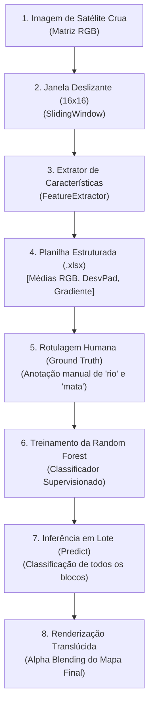

# 🛰️ Visão Computacional em Sensoriamento Remoto: Rio Amazonas

Este repositório documenta um projeto prático de **aprendizado dos fundamentos de Visão Computacional e Machine Learning clássico**, combinando engenharia manual de características (*Feature Engineering*) com o algoritmo **Random Forest** para classificação do uso e cobertura do solo em imagens de sensoriamento remoto (focando no **Rio Amazonas**, áreas de vegetação densa e corpos d'água).

> [!NOTE]
> **Escopo Atual (Prova de Conceito):**
> Este projeto foi intencionalmente testado e validado com **uma única imagem de satélite** (`teste.jpg`). O objetivo desta primeira fase foi pedagógico: compreender a fundo os algoritmos matemáticos e estatísticos de baixo nível (convoluções de gradiente, dispersão lumínica, janelas deslizantes e comitês de árvores de decisão) antes de delegar a extração de padrões para modelos complexos de caixa-preta.

---

## 🧠 Como Funciona o Pipeline de Machine Learning

O fluxo de processamento e classificação opera em 4 etapas interdependentes:



### 1. Engenharia de Características (*Feature Engineering*)
Cada recorte de $16 \times 16$ pixels é resumido em um vetor matemático composto por **5 descritores estatísticos**:
* **Médias dos Canais de Cores ($R, G, B$):** Identifica a assinatura espectral básica (a água absorve luz e reflete mais azul/ciano; florestas refletem verde; solos expostos refletem tons terrosos).
* **Luminância Perceptual (Escala de Cinza):** Ponderação luminosa pelo padrão **ITU-R BT.601** ($0.299R + 0.587G + 0.114B$).
* **Desvio Padrão ($\sigma$):** Mede a **rugosidade global** da textura (a superfície da água calma tem dispersão próxima de zero; copas de árvores com folhas e sombras possuem alta variância de luz).
* **Gradiente Espacial Local ($G$):** Mede a **frequência espacial de bordas** calculando a diferença absoluta de brilho entre pixels vizinhos horizontais e verticais:
  $$G_h = \frac{1}{N} \sum |I_{x, y} - I_{x+1, y}| \quad , \quad G_v = \frac{1}{N} \sum |I_{x, y} - I_{x, y+1}| \quad , \quad G = \frac{G_h + G_v}{2}$$

### 2. Classificação Supervisionada: Random Forest
* O modelo **Random Forest** cria um conjunto de dezenas de árvores de decisão independentes treinadas sobre os vetores de características.
* As árvores aprendem regras de separação estatística (ex: *"Se o desvio padrão for $> 25.0$ e a resposta verde for predominante, classifique como mata"*).
* **Serialização de Pesos:** O modelo treinado é salvo no disco via `joblib` (`.pkl`), permitindo classificar novas imagens instantaneamente sem precisar repetir o processo de anotação e treinamento.

### 3. Síntese do Mapa Temático (*Alpha Blending*)
Em vez de desenhar blocos sólidos opacos, o sistema aplica uma **fusão translúcida** (50% cor temática + 50% foto original):
$$\text{Pixel Final} = (\text{Cor da Classe} \times \alpha) + (\text{Foto Original} \times (1 - \alpha))$$
* **Rio:** Azul `[0, 0, 255]`
* **Mata:** Verde `[0, 255, 0]`

---

## 📂 Arquitetura do Projeto (Orientada a Objetos)

O projeto é estruturado em módulos com responsabilidades únicas e desacopladas:

```text
computer-vision-amazon-river/
│
├── core/
│   ├── models.py         # PatchMetrics: Dataclass que modela o bloco e suas métricas
│   ├── window.py         # SlidingWindow: Gerador (Iterator/Yield) que fatia a imagem
│   ├── features.py       # FeatureExtractor: Métodos matemáticos de extração de textura
│   ├── classifier.py     # Classifier: Random Forest com fit, predict, save e load
│   └── renderer.py       # MapRenderer: Aplica as predições e o alpha blending na imagem
│
├── data/
│   ├── sheets/           # Planilhas Excel com as métricas geradas (.xlsx)
│   ├── slices/           # Recortes individuais dos blocos em PNG
│   └── model/            # Modelos treinados salvos em formato binário (.pkl)
│
├── mapped/               # Diretório de saída dos mapas finais pintados
├── main.py               # Interface de terminal interativa (menu de opções)
├── teste.jpg             # Imagem de satélite para processamento
├── requirements.txt      # Dependências do projeto
└── README.md             # Documentação do projeto
```

---

## 🚀 Como Executar e Usar

### 1. Instalação

1. Clone o repositório:
   ```bash
   git clone https://github.com/matheuslssouza/computer-vision-amazon-river.git
   cd computer-vision-amazon-river
   ```

2. Crie e ative um ambiente virtual:
   ```bash
   # Windows
   python -m venv .venv
   .venv\Scripts\activate
   ```

3. Instale as dependências:
   ```bash
   pip install -r requirements.txt
   ```
   *(Caso não use o requirements.txt: `pip install numpy pillow pandas scikit-learn openpyxl joblib`)*

---

### 2. Guia de Uso Passo a Passo

Execute o script principal:
```bash
python main.py
```

O terminal exibirá o painel interativo:

```text
===================================
    PAINEL DE CLASSIFICAÇÃO
===================================
1 - Extrair caracteristicas de uma imagem e salvar dados da extracao
2 - Treinar modelo
3 - Abrir (carregar) modelo existente
4 - Identificar e mapear
5 - Sair
===================================
```

Siga a sequência abaixo para o pipeline completo:

#### Passo 1: Extrair Características (Opção 1)
* O script percorre a imagem `teste.jpg`, fatia em blocos de $16 \times 16$ pixels, extrai as métricas de cada bloco e salva em uma planilha Excel (ex: `teste.xlsx` dentro de `data/sheets/`).
* Os recortes de cada bloco também são salvos em `data/slices/`.

#### Passo 2: Rotulagem Humana (No Excel)
* Abra a planilha gerada (`data/sheets/teste.xlsx`) no Excel.
* Localize a coluna **`label`**.
* Inspecione alguns recortes da pasta `data/slices/` e anote algumas linhas de referência (ex: digite `"rio"` em 10 linhas e `"mata"` em 10 linhas). Deixe o restante das linhas em branco.
* Salve e feche a planilha.

#### Passo 3: Treinar o Modelo (Opção 2)
* Selecione a opção **2** e informe o nome da planilha.
* O algoritmo **Random Forest** será treinado com base nas suas anotações e os pesos aprendidos serão salvos automaticamente em `data/model/random_forest_trainned.pkl`.

#### Passo 4: Identificar e Mapear (Opção 4)
* Selecione a opção **4**.
* O classificador prevê a categoria de **todos** os blocos da foto inteira em lote.
* O `MapRenderer` gera o mapa temático colorido sobreposto e salva o resultado final na pasta `mapped/`.

#### Passo Alternativo: Reutilizar Modelo sem Treinar (Opção 3)
* Caso já possua um modelo previamente treinado, use a opção **3** para carregar os pesos `.pkl` do disco e pule direto para a opção **4**.

---

## 🔮 Próximos Passos: Da Visão Clássica ao Deep Learning

A abordagem deste repositório representa o fluxo **clássico** de Visão Computacional. O próximo grande salto do projeto será a transição para **Redes Neurais Artificiais e Deep Learning** (como Redes Convolucionais - CNNs e arquiteturas de Segmentação Semântica como **U-Net** ou **SegNet**).

### 🔄 O que muda na metodologia?

| Aspecto | Abordagem Atual (Machine Learning Clássico) | Próximo Passo (Deep Learning / Redes Neurais) |
| :--- | :--- | :--- |
| **Extração de Características** | **Manual:** Nós decidimos e programamos a matemática das features (médias RGB, $\sigma$, gradientes $G$). | **Automática (*Feature Learning*):** A rede neural convolucional decide sozinha quais filtros e padrões visuais extrair da imagem bruta. |
| **Formato do Dataset** | **Planilha Tabular:** Linhas e colunas com números estatísticos calculados previamente. | **Imagens + Máscaras Anotadas:** Dataset de imagens de satélite acompanhadas de suas respectivas máscaras binárias/coloridas anotadas (polígonos ou pintura pixel a pixel delimitando rio vs. mata). |
| **Granularidade do Mapeamento** | **Grade de Blocos ($16 \times 16$ px):** Classificação bloco a bloco por janela deslizante. | **Pixel a Pixel (Segmentação Semântica):** A rede prevê a classe exata de cada pixel individualmente, gerando contornos ultra-precisos e orgânicos do curso do rio. |
| **Entrada e Saída** | `[R, G, B, Desvio, Gradiente] -> "rio"` | `[Imagem de Satélite RGB] -> [Máscara Cartográfica Completa]` |

Essa evolução permitirá comparar diretamente o custo computacional, a acurácia das bordas e o esforço de anotação de dados entre a **visão clássica com Random Forest** e o **Deep Learning ponta a ponta**.

---

*Projeto desenvolvido para fins de estudo e experimentação prática em IA e Sensoriamento Remoto.*
