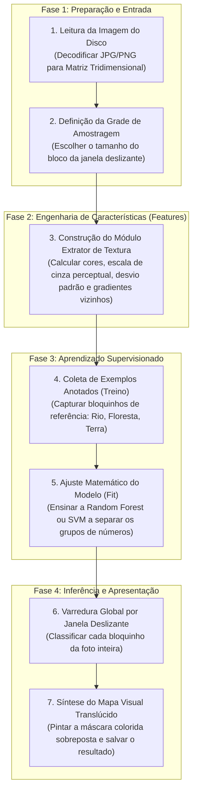
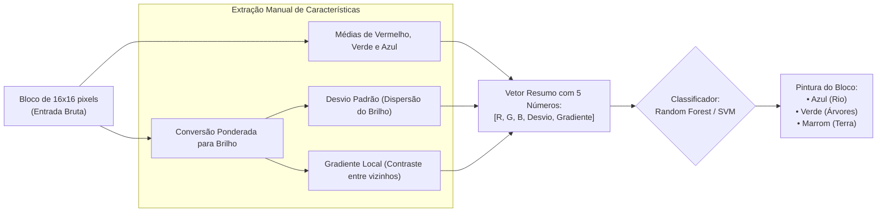

# Roteiro Conceitual e Arquitetura do Projeto: Classificação de Imagens com Visão Computacional e Machine Learning

Este documento não contém código pronto. Ele é um **roteiro de engenharia e raciocínio lógico** desenhado para que você mesmo escreva o seu código do zero, entendendo cada engrenagem conceitual, o porquê de cada decisão e o que cada etapa precisa realizar.

---

## 1. Diagrama de Fluxo Geral (O Pipeline de Execução)

O processo para transformar uma foto de satélite crua em um mapa temático classificado segue rigorosamente as 7 etapas abaixo:

---

## 2. Diagrama de Decisão Dentro de Cada Bloco de Imagem

Para entender o que o computador faz centenas de vezes por segundo enquanto varre o mapa:

---

## 3. Explicação Detalhada: Etapa por Etapa do que Você Precisa Construir

Abaixo está o que você precisa planejar e implementar mentalmente e estruturar em seu script.

---

### ETAPA 1: Carregar o Arquivo e Entender a Matriz na Memória
* **O que você precisa fazer:**
  Você precisa abrir o arquivo de imagem do disco e convertê-lo para um formato de matriz com números manipuláveis (como ponto flutuante).
* **Por que fazer isso?**
  No disco, um arquivo `.jpg` ou `.png` é um fluxo comprimido de bytes ilegível para a matemática. Ao decodificá-lo, ele se torna uma tabela tridimensional: linhas (altura), colunas (largura) e 3 fatias de profundidade que guardam a quantidade de luz Vermelha, Verde e Azul de cada ponto.
* **O que você deve garantir:**
  Converta os valores para números decimais (ponto flutuante), pois se mantiver como inteiros de 8 bits (0 a 255), ao fazer cálculos de médias e subtrações nas próximas etapas, o computador pode arredondar os valores para zero ou dar estouro de memória negativa.

> 💡 **Dica de Bibliotecas e Funções para a Etapa 1:**
> * **Biblioteca:** `PIL` (módulo `Image` do pacote `Pillow`) para abrir o arquivo, e `numpy` para a matriz numérica.
> * **Funções recomendadas:**
>   * `Image.open("caminho_da_imagem.jpg")` $\to$ decodifica o arquivo do disco.
>   * `.convert("RGB")` $\to$ garante que a imagem tenha exatamente 3 canais de cor (descarta transparências alpha como PNGs de 4 canais ou escalas de cinza de 1 canal).
>   * `np.array(imagem, dtype=np.float32)` $\to$ converte o objeto da imagem para uma matriz NumPy de números decimais (*float*).
>   * `.shape` $\to$ propriedade da matriz que te devolve a tupla `(altura, largura, canais)`.

---

### ETAPA 2: A Função Extratora de Características (O Coração da Visão)
Você precisará criar uma função que receba apenas um pequeno pedaço recortado da imagem (por exemplo, um quadrado de $16 \times 16$ pixels) e devolva uma lista com números que resumam a "alma" daquele quadrado.

Aqui dentro você calculará 5 coisas:

#### 2.1 As Médias de Cores (R, G, B)
* **O que fazer:** Calcular a média aritmética de cada um dos três canais de cor daquele quadrado.
* **Por que:** É a assinatura cromática básica. A vegetação saudável reflete muito verde; solos argilosos ou arenosos refletem mais vermelho e amarelo; a água absorve quase tudo ou reflete mais azul/ciano.

#### 2.2 A Transformação em Tons de Cinza Perceptual
* **O que fazer:** Criar uma imagem 2D daquele quadrado onde cada pixel perde a informação de cor e ganha um único valor de brilho. Para isso, você multiplica o canal Vermelho por aproximadamente 30%, o Verde por 59% e o Azul por 11%, e soma os três.
* **Por que:** O olho humano (e as regras físicas de dispersão de luz) enxerga luminosidade predominantemente no espectro verde. Não adianta usar a cor para calcular textura; a textura é a variação de **luz e sombra**.

#### 2.3 O Desvio Padrão (Métrica de Rugosidade Global)
* **O que fazer:** Pegar todos os pixels cinzas do quadrado, calcular o quanto cada pixel se afasta da média do próprio quadrado, elevar essa distância ao quadrado, tirar a média e extrair a raiz quadrada.
* **Por que:** Esta é a métrica mestra da litologia e do sensoriamento remoto. Uma lâmina d'água de rio ou um mineral de extinção uniforme tem quase todos os pixels com valores iguais; o desvio padrão é minúsculo (perto de zero). Já a copa de árvores vista de cima ou uma rocha com grãos de quartzo e biotita misturados tem pixels claros do lado de fendas escuras, resultando em um desvio padrão enorme.

#### 2.4 Os Gradientes Espaciais (Métrica de Microtextura e Bordas)
* **O que fazer:** 
  1. No sentido horizontal: subtrair o valor de cada pixel pelo valor do pixel que está imediatamente à direita dele.
  2. No sentido vertical: subtrair cada pixel pelo que está imediatamente abaixo dele.
  3. Descartar os sinais negativos (usar módulo/valor absoluto) e calcular a média dessas diferenças.
* **Por que:** O desvio padrão mede se existem tons diferentes, mas não sabe se eles estão espalhados ou concentrados. O gradiente mede a **frequência espacial**. Em florestas, a cada 1 pixel a intensidade salta drasticamente de luz para sombra. No rio ou em um lago, mesmo que a água tenha uma leve transição suave de profundidade, vizinhos imediatos têm praticamente o mesmo número.

> 💡 **Dica de Bibliotecas e Funções para a Etapa 2:**
> * **Biblioteca:** Apenas `numpy`.
> * **Funções e operações recomendadas:**
>   * `np.mean(matriz)` $\to$ calcula a média aritmética de todos os elementos.
>   * `matriz[:, :, 0]`, `matriz[:, :, 1]`, `matriz[:, :, 2]` $\to$ operador de fatiamento (*slicing*) para isolar os canais R, G e B respectivamente.
>   * `np.std(matriz_cinza)` $\to$ calcula o desvio padrão diretamente.
>   * `matriz_cinza[:, :-1]` vs `matriz_cinza[:, 1:]` $\to$ técnica de alinhamento com fatiamento para subtrair todos os pixels de seus vizinhos da direita de uma só vez sem usar loops lentos.
>   * `np.abs(...)` $\to$ calcula o módulo / valor absoluto das diferenças de intensidade.

---

### ETAPA 3: A Coleta de Exemplos Conhecidos (O Papel do "Especialista")
* **O que você precisa fazer:**
  Você precisa escolher e anotar no seu código as coordenadas de alguns poucos pontos da sua foto onde você tem certeza absoluta do que existe:
  * Pelo menos 2 coordenadas no meio do Rio (Classe 0).
  * Pelo menos 2 coordenadas no meio da Vegetação (Classe 1).
  * Pelo menos 2 coordenadas no meio do Solo/Terra (Classe 2).
* **Por que:**
  O Machine Learning supervisionado não adivinha o que os números significam. Ele precisa que você aponte: *"olha, este vetor com desvio 2.1 e gradiente 1.4 é ÁGUA; este outro com desvio 42.0 e gradiente 22.5 é FLORESTA"*.
* **O que o seu código deve fazer nesta etapa:**
  Ir até essas coordenadas que você escolheu, recortar um bloquinho ao redor de cada uma, passar pelo extrator que você criou na Etapa 2 e guardar os vetores de números numa lista de treino, junto com os seus rótulos (0, 1 ou 2).

> 💡 **Dica de Bibliotecas e Funções para a Etapa 3:**
> * **Biblioteca:** Estruturas nativas do Python (`dict`, `list`) e `numpy`.
> * **Funções e operações recomendadas:**
>   * Um dicionário Python `{0: [(y1, x1), (y2, x2)], 1: [...], 2: [...]}` para mapear a classe com as tuplas de coordenadas.
>   * Fatiamento 2D na matriz original: `imagem_np[y_inicio:y_fim, x_inicio:x_fim]` para recortar o bloco centralizado na coordenada.
>   * `.append(...)` em listas Python para juntar os vetores de características e os rótulos.
>   * `np.array(lista_treino)` $\to$ converter a lista final em uma matriz 2D que o classificador aceita como entrada de dados de treino.

---

### ETAPA 4: A Escolha e o Treinamento do Modelo de Machine Learning
* **O que você precisa fazer:**
  Instanciar um algoritmo classificador (como a **Random Forest** ou o **SVM**) e chamar o método de ajuste (`fit`) passando a lista de vetores numéricos e a lista de rótulos.
* **Por que a Random Forest é ótima para você começar:**
  A Random Forest é um comitê de dezenas de árvores de decisão. Cada árvore vai olhar para os seus números e aprender regras em cascata: *"Se o desvio for menor que 8, então olhe se a cor verde é menor que 50; se for, marque como água"*. Com muitas árvores votando, o modelo fica extremamente robusto e tolera pequenas imprecisões nas coordenadas que você escolheu.
* **E se você quiser usar o SVM?**
  O SVM fará algo diferente: ele vai considerar cada uma das 5 características como um eixo em um espaço de 5 dimensões e tentará desenhar a fronteira matemática mais ampla possível que separe a nuvem de pontos da água da nuvem de pontos das árvores.

> 💡 **Dica de Bibliotecas e Funções para a Etapa 4:**
> * **Biblioteca:** `scikit-learn` (`sklearn`).
> * **Classes recomendadas:**
>   * Para Random Forest: `from sklearn.ensemble import RandomForestClassifier`
>     * Instanciação: `RandomForestClassifier(n_estimators=50, random_state=42)`
>   * Para SVM: `from sklearn.svm import SVC`
>     * Instanciação: `SVC(kernel='rbf', C=1.0)`
> * **Método essencial:**
>   * `modelo.fit(X_treino, y_treino)` $\to$ executa o algoritmo de aprendizado com os dados e cria a árvore ou hiperplano.

---

### ETAPA 5: A Varredura da Imagem Inteira (Inferência por Janela Deslizante)
* **O que você precisa fazer:**
  Criar dois laços de repetição aninhados:
  * Um laço vertical que anda de 16 em 16 pixels do topo até o rodapé da imagem.
  * Um laço horizontal que anda de 16 em 16 pixels da esquerda para a direita.
* **Para cada posição da janela:**
  1. Recortar o bloco atual de $16 \times 16$.
  2. Passar o bloco pela sua função da Etapa 2 para obter seus 5 números.
  3. Pedir para o modelo treinado na Etapa 4 prever a qual classe aquele bloco pertence.
* **Por que dar passos do tamanho do bloco (16 pixels)?**
  Porque assim você divide a imagem inteira em uma grade perfeita de ladrilhos, sem deixar nenhum pixel para trás e sem repetir cálculos desnecessários.

> 💡 **Dica de Bibliotecas e Funções para a Etapa 5:**
> * **Funções nativas e do modelo:**
>   * `range(inicio, fim, passo)` $\to$ função nativa do Python com o argumento de `passo = 16` para pular de bloco em bloco.
>   * `modelo.predict([vetor_features])[0]` $\to$ passa o vetor do bloco (dentro de uma lista ou array de 1 amostra) e retorna o número da classe predita (`0`, `1` ou `2`).

---

### ETAPA 6: A Construção do Mapa Visual Sobreposto
* **O que você precisa fazer:**
  Conforme o modelo classifica cada bloco, você não quer apenas cuspir números no terminal; você quer gerar uma imagem final para os olhos humanos.
  1. Defina uma tabela de cores:
     * Classe 0 (Rio) $\to$ Azul `[0, 100, 255]`
     * Classe 1 (Árvores) $\to$ Verde `[34, 139, 34]`
     * Classe 2 (Solo) $\to$ Marrom `[210, 180, 140]`
  2. Faça uma **fusão alfa (translucidez)**: pegue os pixels originais da foto naquele bloco e misture meio a meio (50% do pixel original + 50% da cor da classe).
  3. Escreva essa mistura sobre a matriz da imagem final.
* **Por que fazer translúcido em vez de pintar sólido?**
  Porque pintar sólido cria blocos opacos feios onde você não consegue mais enxergar a geografia por baixo. Com a mistura translúcida, você vê a curva do rio, as copas das árvores e as estradas através da tinta colorida, confirmando se o algoritmo acertou o contorno exato!

> 💡 **Dica de Bibliotecas e Funções para a Etapa 6:**
> * **Biblioteca:** `numpy`.
> * **Operações recomendadas:**
>   * `np.copy(imagem_original)` $\to$ cria uma cópia independente da matriz original para você não alterar a foto de entrada.
>   * Fórmula de fusão alfa por broadcast direto em NumPy: `0.5 * bloco_original + 0.5 * np.array(cor_classe)`.
>   * Atribuição direta por fatiamento: `mapa[y:y+16, x:x+16] = bloco_misturado`.

---

### ETAPA 7: Salvar o Resultado e Avaliar
* **O que você precisa fazer:**
  Converter a matriz final de volta para o formato de imagem (inteiros de 8 bits sem sinal, de 0 a 255) e salvar como um novo arquivo (por exemplo, `resultado_marcado.png`).
* **Como avaliar criticamente:**
  Abra a imagem resultante lado a lado com a original:
  * O rio ficou azul sem "vazar" para a terra? Se vazou, significa que a margem do rio tem água rasa ou terra escura e precisa de mais exemplos de treino.
  * As árvores ficaram verdes mesmo nas áreas onde bateu menos sol? O desvio padrão e o gradiente devem ter garantido isso, mesmo onde a cor verde ficou mais escura!

> 💡 **Dica de Bibliotecas e Funções para a Etapa 7:**
> * **Bibliotecas:** `numpy` e `PIL` (`Image`).
> * **Funções recomendadas:**
>   * `.astype(np.uint8)` $\to$ converte a matriz decimal de volta para inteiros de 8 bits sem sinal (`uint8`), exigido pelo formato de imagem PNG/JPG.
>   * `Image.fromarray(matriz_uint8)` $\to$ transforma a matriz NumPy em um objeto de imagem exportável.
>   * `.save("caminho_de_saida.png")` $\to$ grava o arquivo final no disco.
